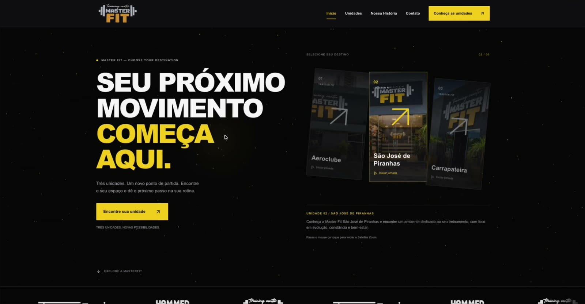
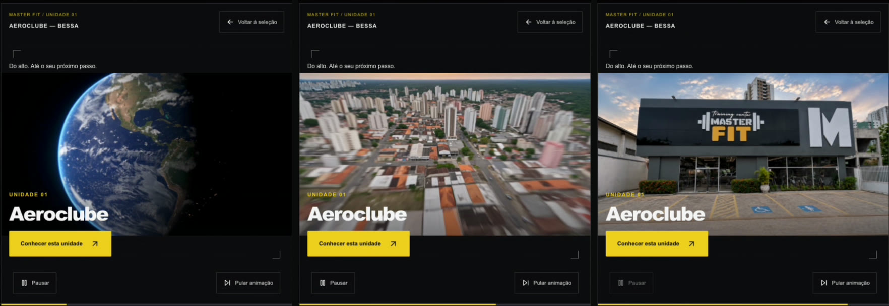
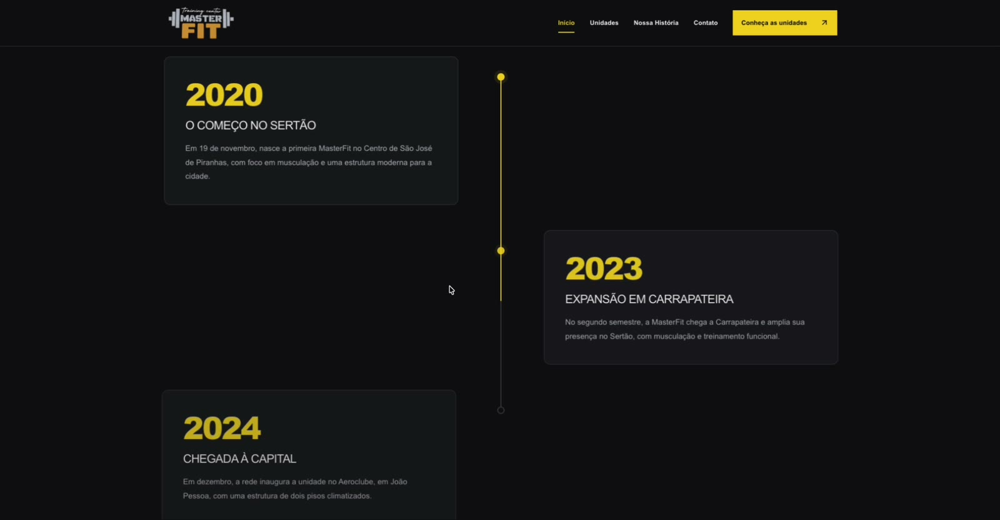
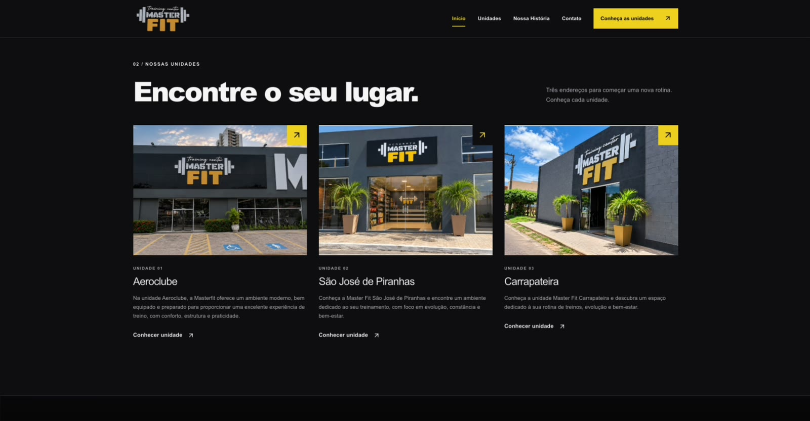
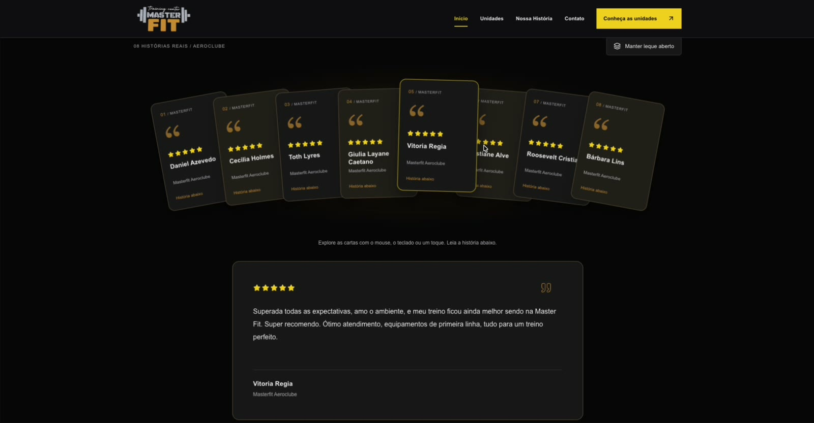
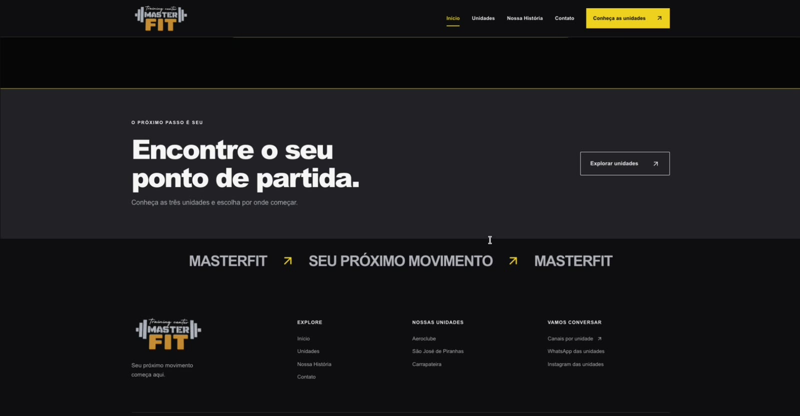
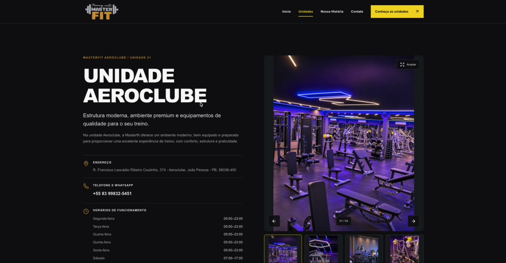
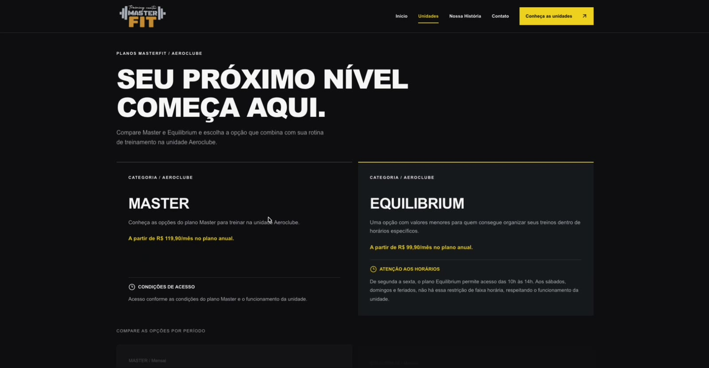
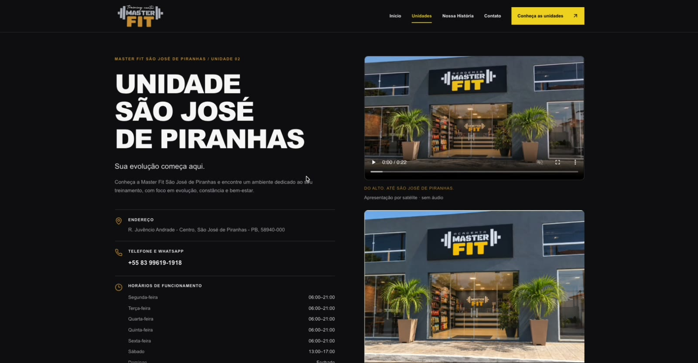
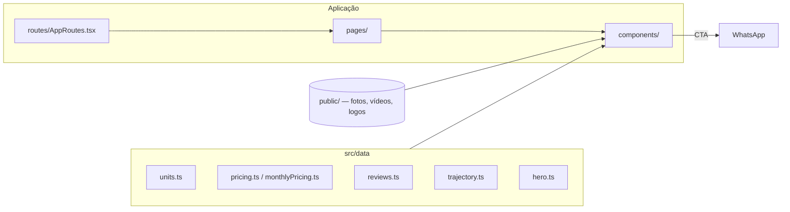

<div align="center">


# MasterFit — Seu próximo movimento

Site institucional da rede de academias **MasterFit**, com três unidades na Paraíba:
**Aeroclube** (João Pessoa), **São José de Piranhas** e **Carrapateira**.


</div>

---

## Filme de lançamento

https://github.com/user-attachments/assets/d68c0107-1052-4fe4-b00d-80734f30e67e

## O site em movimento

https://github.com/user-attachments/assets/762175fb-d9c4-4fe9-a08a-fc7442f6e6de

---

## Sobre o projeto

Uma experiência escura, cinematográfica e responsiva para apresentar a marca, sua trajetória e cada unidade, com foco em exploração e em conversão pelo WhatsApp.

O site é **100% front-end**: não há backend, checkout, cadastro nem área do aluno. Todo o conteúdo institucional (unidades, horários, planos, avaliações e trajetória) vive em arquivos de dados tipados, separados dos componentes.

## Visão geral

### Hero interativa

Três caminhos, um para cada unidade. Ao escolher um destino, um vídeo faz a aproximação do satélite até a fachada real da academia.





### Nossa trajetória

Timeline vertical com os marcos da rede. A linha amarela acompanha a rolagem e retrocede ao subir a página.



### Nossas unidades



### Histórias de quem treina

Avaliações reais em um leque de cartas: passar o mouse, focar pelo teclado ou tocar em uma carta atualiza a história exibida abaixo.



### CTA final e rodapé



### Páginas das unidades

Todas as unidades usam um único template, com apresentação, fotos e vídeos reais, localização, funcionamento, planos e contatos.

| Catálogo de unidades | Unidade Aeroclube |
| :---: | :---: |
|  |  |
| **Planos Master e Equilibrium** | **Unidade São José de Piranhas** |
|  |  |

## Funcionalidades

- **Hero cinematográfica:** prévia por hover, abertura por clique, teclado ou toque; controles de pausar, continuar, pular e voltar; imagem alternativa em caso de erro; `Esc` para retornar. Só o vídeo escolhido é carregado.
- **Fundo de partículas magnéticas** desenhado em `<canvas>`, com física independente da taxa de quadros e densidade reduzida no mobile.
- **Esteira da marca** com a logo MasterFit intercalada a uma frase de efeito, sem emenda e com botão de pausa.
- **Timeline sincronizada com a rolagem**, com entradas animadas que acontecem uma única vez.
- **Leque de depoimentos** sem setas nem modal: a última história escolhida permanece visível.
- **Galeria de fotos** com miniaturas, ampliação e navegação.
- **Página de planos** (`/planos`) com as opções das três unidades em um só lugar, lidas das mesmas fontes de dados das páginas das unidades.
- **Planos por unidade**, com CTAs que abrem o WhatsApp já com a unidade e o plano escolhidos na mensagem.
- **Mapas de localização** e links oficiais de Instagram e WhatsApp por unidade.
- **Página 404** com `noindex` e redirecionamento da antiga rota `/sobre` para a seção de trajetória.

## Tecnologias

| Camada | Tecnologia | Uso |
| --- | --- | --- |
| Interface | **React 19** | Componentes e estado da interface |
| Linguagem | **TypeScript 5.7** | Tipagem dos componentes e dos dados |
| Build | **Vite 6** | Servidor de desenvolvimento e build de produção |
| Rotas | **React Router 7** | Navegação SPA, rotas dinâmicas por unidade e 404 |
| Estilo | **Tailwind CSS 4** + CSS próprio | Utilitários e folhas de estilo por seção, com tokens de design |
| Ícones | **Lucide React** | Ícones da interface |
| Animação | CSS, `IntersectionObserver`, `requestAnimationFrame` | Sem bibliotecas de animação |
| Qualidade | **ESLint 9** + `node:test` | Lint e testes unitários |
| Hospedagem | **Vercel** | Configuração SPA e cabeçalhos de segurança em `vercel.json` |

## Arquitetura



Os componentes nunca guardam endereço, horário, preço ou contato: tudo vem de `src/data`. Para alterar uma unidade, basta editar o objeto dela em `units.ts`, e as páginas, a Hero e os cards se atualizam juntos.

```text
src/
├── components/
│   ├── home/        Hero, vídeo cinematográfico, partículas, timeline, depoimentos, faixa de logos
│   ├── units/       Template de unidade, galeria, mapa, planos, cards
│   ├── layout/      Header e Footer
│   └── ui/          Botões, títulos de seção, container e outros blocos reutilizáveis
├── data/            Unidades, planos, avaliações, trajetória e destinos da Hero
├── hooks/           Navegação (título, descrição, foco e âncoras) e revelações por rolagem
├── pages/           Home, Unidades, Planos, Contato e 404
├── routes/          Definição das rotas
└── styles/          Tokens de design e estilos por seção
public/
├── assets/          Logos oficiais e fotos das unidades (JPG/WebP em vários tamanhos)
└── videos/          Vídeos de aproximação por satélite e quadros finais
```

### Rotas

| Rota | Página |
| --- | --- |
| `/` | Home |
| `/unidades` | Catálogo das três unidades |
| `/unidades/aeroclube` | Unidade Aeroclube |
| `/unidades/sao-jose-de-piranhas` | Unidade São José de Piranhas |
| `/unidades/carrapateira` | Unidade Carrapateira |
| `/planos` | Planos de todas as unidades |
| `/contato` | Canais por unidade |
| `/sobre` | Redireciona para `/#trajetoria` |
| Qualquer outra | Página 404 (`noindex`) |

## Design system

| Token | Cor | Papel |
| --- | --- | --- |
| Background | `#0B0B0D` | Fundo principal |
| Surface | `#18191D` | Cards e painéis |
| Surface elevada | `#24252A` | Destaques de superfície |
| Amarelo principal | `#F4CF1A` | Interações e destaques |
| Amarelo hover | `#FFE147` | Estado de hover |
| Dourado da marca | `#D09636` | Detalhes da identidade |
| Texto | `#F7F7F7` | Texto principal |
| Texto secundário | `#B8BAC1` | Apoio e legendas |
| Roxo de atmosfera | `#7137A8` | Atmosfera das fotografias |

Todas as cores, espaçamentos e tempos de transição estão centralizados em `src/styles/tokens.css`.

## Acessibilidade e desempenho

- Navegação completa por teclado, com foco visível e restauração de foco ao fechar a experiência da Hero.
- Respeito a `prefers-reduced-motion`: as animações são reduzidas ou substituídas por estados estáticos.
- Regiões `aria-live` anunciam a história e a foto selecionadas; elementos ocultos usam `inert`.
- Título, descrição e `robots` atualizados a cada rota.
- Vídeos montados somente quando escolhidos (`preload="none"`) e imagens em vários tamanhos.

## Como rodar

Requer **Node.js 20.19+** ou **22.12+**.

```bash
npm install
npm run dev
```

| Comando | O que faz |
| --- | --- |
| `npm run dev` | Servidor de desenvolvimento |
| `npm run build` | Checagem de tipos e build de produção em `dist/` |
| `npm run preview` | Serve o build localmente |
| `npm run lint` | Lint com ESLint |

Testes da física das partículas:

```bash
node --experimental-strip-types --test src/components/home/magneticParticles.test.ts
```

## Deploy

O projeto já está configurado para a Vercel em `vercel.json`: build com Vite, saída em `dist/`, redirecionamento de todas as rotas para `index.html` (SPA) e cabeçalhos `X-Content-Type-Options`, `Referrer-Policy` e `X-Frame-Options`.

## Atualizações

### Esteira da marca, página de planos e datas da trajetória — 18/11/2026

- **Esteira (Home):** `InfiniteLogoMarquee.tsx` e `logo-marquee.css` exibem apenas a logo MasterFit (mesma máscara do arquivo original), intercalada com a frase de `MARQUEE_PHRASE` (“EVOLUÇÃO EM CADA TREINO.”) e um ponto amarelo. Quatro pares por grupo garantem grupos maiores que a viewport; os dois grupos idênticos com `translateX(-50%)`, a velocidade (~50 px/s desktop, ~40 px/s mobile), a pausa e os gradientes foram mantidos. Com movimento reduzido, aparece um único par estático e centralizado. Technogym e Hammer Strength deixaram de ser referenciados; os arquivos continuam em `public/assets/brand/marquee/`.
- **Planos (`/planos`):** nova página `src/pages/Plans.tsx` com `PageHero`, âncoras por unidade, um bloco por unidade (`planos-aeroclube`, `planos-sao-jose-de-piranhas`, `planos-carrapateira`) com link para a página da unidade e `CTASection` para `/unidades`. Os preços vêm sempre de `pricing.ts` e `monthlyPricing.ts`, pelos componentes existentes. `PricingSection` e `MonthlyPricingSection` ganharam props opcionais `sectionId`, `idPrefix` e `headingLevel`, cujo padrão reproduz a saída anterior; `plans.css` aplica aos títulos rebaixados a mesma aparência das páginas das unidades. Item “Planos” no menu e no rodapé (`site.ts`), rota, título e descrição (`usePageNavigation.ts`) e entrada no `sitemap.xml`. Em `global.css`, os links do menu não quebram linha entre 761 e 1050 px.
- **Trajetória:** `trajectory.ts` corrigido conforme o proprietário: Carrapateira em maio de 2025 e Aeroclube em outubro de 2025; São José de Piranhas (19/11/2020) mantido. Cada marco tem `id` (usado como `key`), rótulo visível (“2020”, “MAI 2025”, “OUT 2025”) e `dateTime` ISO.

Verificações: `npm run lint`, `npm run build`, os seis testes das partículas e `audit/verify-static.mjs` passaram. Hashes SHA-1 confirmaram Hero, vídeo, partículas, Header, Footer, avaliações, dados das unidades, preços e tokens sem alteração; o HTML renderizado das três páginas de unidade ficou idêntico ao anterior (SHA-256). No navegador: esteira sem as marcas removidas, grupos de mesma largura, pausar/retomar e o modo de movimento reduzido (regras ativadas via CSSOM); `/planos` com três blocos, âncoras, 13 links de WhatsApp idênticos aos das páginas das unidades, nenhum `id` duplicado, um único `h1` e títulos sem saltos de nível; timeline 2020 → MAI 2025 → OUT 2025 com barra de progresso e marcos ativos corretos; menu mobile em 320 px com Esc e retorno de foco; sem overflow horizontal em 320, 390, 820 e 1280 px; console sem erros.

Pendências: o print `docs/readme/03-trajetoria.jpg` ainda mostra as datas antigas e precisa ser refeito; o histórico em `docs/HISTORICO-DESENVOLVIMENTO.md` foi mantido como registro da época.

## Documentação

- [Histórico de desenvolvimento](docs/HISTORICO-DESENVOLVIMENTO.md)
- [Relatório de auditoria pré-deploy](audit/RELATORIO-PRE-DEPLOY.md)

---

<div align="center">

Marca, fotografias, vídeos e avaliações são materiais reais da MasterFit.

</div>
